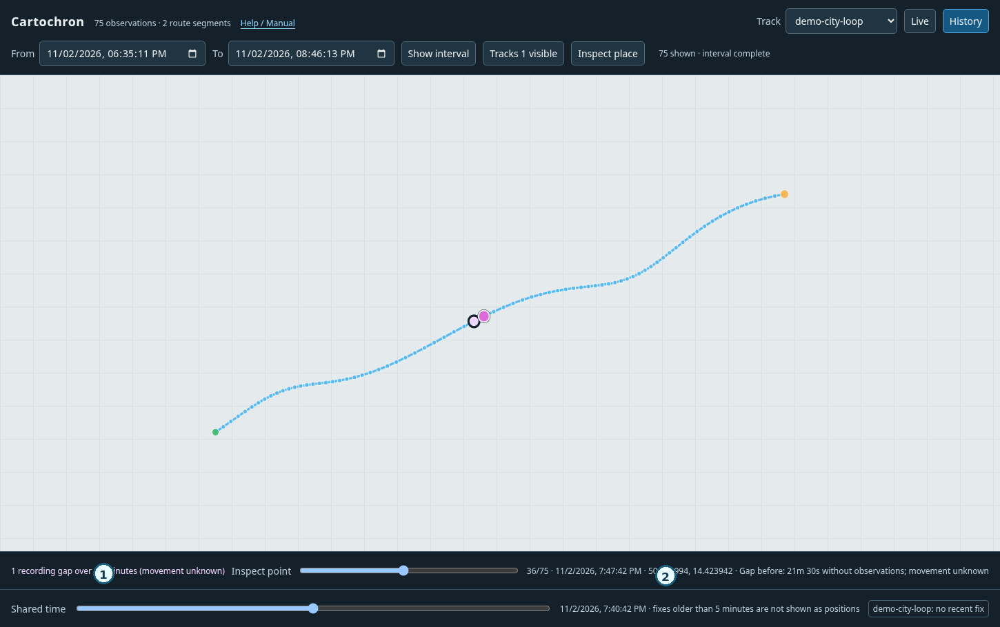
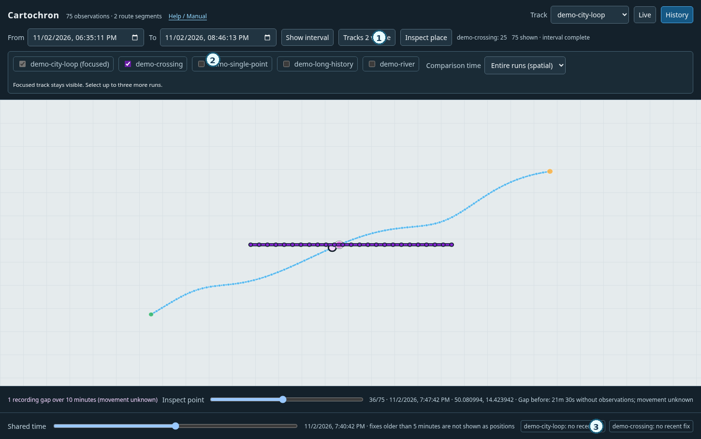

# The Cartochron handbook

*An operator's guide to observing, comparing, and questioning location evidence.*

This is the first **living edition**, covering the implemented v0.1-era
analysis tools. Planned capabilities are described separately in
[the project vision](vision.md); nothing in that document should be
mistaken for a working control.

For a compact illustrated guide inside the running application, open
**Help / Manual** (`/help`). For installation commands and disaster recovery,
consult [Operations](operations.md). This handbook is organized around
*questions an investigator wants to answer*, not around program files.

## Part I — Know what you're looking at

**An observation** says that a producer reported coordinates to Cartochron.
Cartochron stamps the time it *received* the report. When a producer supplies
its own acquisition time, the two clocks are displayed separately. An
observation may be old, inaccurate, cached, or incomplete. Cartochron does
not independently verify the phone or the person's physical presence.

**A source** is an enrolled, operator-chosen identity; **a channel** is the
configured acquisition input; **a run** is one recording session. A single
source may be observed via several channels, and each channel may produce
several independent runs. The original associations are preserved even when
an operator changes a display label.

| On the map | What it can support | What it cannot prove |
| --- | --- | --- |
| Recent receipts | A position report reached the server recently | The producer is currently connected or the device is physically there |
| Last recorded point | The most recent stored report for a run | Continuous presence since the report |
| Route line | The visual order of *recorded* observations | An observed journey between the points |
| Broken line / gap | No supporting reports for an interval beyond the threshold | Device absence or any particular movement in the gap |
| Two routes crossing | Recorded geographic overlap | A meeting without temporal and independent supporting evidence |

### The first rule

**Do not turn an absence of observation into an observation of absence.**
Always examine acquisition quality, time coverage, and the amount of history
actually loaded before interpreting a pattern.

## Part II — Start with safe, reproducible evidence

Use synthetic data first. In a fresh Cartochron checkout:

```sh
make
python3 demo.py --db /tmp/cartochron-handbook-demo.sqlite3
python3 map_server.py --db /tmp/cartochron-handbook-demo.sqlite3
```

Choose a **new** database path each time: the demo refuses to overwrite
existing records. Open `http://127.0.0.1:8765/`, then **History**. No phone,
Metasploit session, or GPS hardware is needed. Avoid using real locations in
examples, issues, or screenshots intended for publication.

For the production lifecycle, run the receiver with a private persistent
SQLite file or its supported Compose deployment. Back up before a schema
upgrade. See [Operations](operations.md) for permissions, TLS, authentication,
stop/start, and restore procedures.

## Part III — Acquire without coupling collection to analysis

The core receiver exposes an HTTP observation contract, rather than requiring
one specific kind of tracker. The current independent adapters include:

- [cartochron-gpsd](https://github.com/cartochron/cartochron-gpsd): subscribes
  to GPSD TPV reports and may include producer-reported fix time and estimated
  error. GPSD's input path is a configured channel, not authenticated phone
  identity.
- [cartochron-metasploit](https://github.com/cartochron/cartochron-metasploit):
  uses an authorized Android Meterpreter session. Its location can be the
  Android network provider's *last-known* value, with unknown fix age and
  accuracy. The adapter may send a stable `CHANNEL_ID`; omit `TRACK_ID` to
  generate a new run for each job.

Both produce ordinary observations. Importing GPX/KML/KMZ, incident feeds,
and road-restriction overlays are future capabilities, **not** implemented
core inputs. The [data contracts](data-contracts.md) describe boundaries for
future event and artifact types.

## Part IV — Ask better questions with the map

### 1. Monitor: what has been reported lately?

Monitor groups known channels or enrolled sources rather than filling the
selector with every old recording job. Each identity follows its newest run
when fresh observations arrive. **Recent receipts** means recent data, not a
verified connection. Select **Show inactive positions** to inspect stale last
positions deliberately; do not interpret them as current locations.

Camera modes are operator-controlled: **Free** avoids automatic recentering,
**Follow selected** follows one chosen entry with reduced jitter, **Follow
visible** frames the shown sources together, and **Fit visible** reframes
once. Manual camera movement returns to Free. A selected run's trail never
joins older runs or another channel's positions.

### 2. History: what was recorded, and when?

Switch to History and browse recording runs separately. Filter by stored
source or channel, page into older runs, then select a time interval.
Cartochron uses a **half-open interval** `[from, to)` on the *receipt clock*.
History requests and rendered pages are bounded; a partial result does not
mean older observations do not exist. If you change the interval, note its
local-time display and the receiver's UTC semantics.

### 3. Points, gaps, and suspect jumps

Inspect individual points instead of reasoning from the line alone. A gap
larger than ten minutes breaks the rendered route. Some abrupt apparent
movements are separately flagged as *possible positioning jumps*, based on
server receipt time. Neither rule tells you where the subject traveled or
whether the GPS report was wrong.



*Figure 1 — Synthetic recording gap. Inspect the endpoints and the time
between them; the missing interval is not a reconstructed route.*

### 4. Compare tracks: does a spatial crossing matter?

Select a focused run, open **Tracks**, and add up to three comparison runs.
Use **Entire runs (spatial)** to study where recorded paths overlap, or **Same
interval** when temporal coverage matters. Read the recording intervals
before making claims about proximity or repeated passage.



*Figure 2 — The blue and violet recorded routes cross. Their shared geography
alone cannot establish that two sources met. The shared-time result below
is a separate question.*

### 5. Shared time: what was actually observed together?

Move the **Shared time** cursor in History. For each loaded run, Cartochron
selects the latest actual fix at or before the chosen instant **only when no
more than five minutes old**. It does not interpolate positions. A missing
qualifying fix means **no sufficiently recent loaded observation**, not
proof that the source was somewhere else.

### 6. Inspect a place: who was recorded near this area?

In History, open **Inspect place**, select a radius, and click an area. The
first list examines **loaded, visible recordings**. Its scope is deliberately
limited to the selected runs and loaded pages.

Press **Search recorded history** to ask a different question: *which individual
recorded observations, across all saved runs, fall within this radius?* This
second list returns the supporting observations with exact run IDs, channel
and source labels if known, receipt times, reported fix provenance and computed
distance. Use **Older search page** until the cursor is exhausted. A page with
no matches may still have older candidates; do not interpret it as complete.
The search is not a frozen database snapshot while acquisition continues.

Use **Scope** to restrict the search to an enrolled source or configured
channel; an unfiltered search covers all recorded identities. **From** and
**To** restrict the server's *receipt clock*, using the operator's local time
in the browser. This is not the same as a producer-reported GPS fix time.

Above the raw evidence, the browser shows *matching-fix groups* from the
observations it has retrieved so far. They join **only matching points of the
same run** when successive receipt times are at most five minutes apart. Such
groups can split or change as older pages arrive. They say nothing about what
happened between the fixes, even if their timestamps are close. In particular,
they are **not visits, dwell times or co-presence conclusions**.

### 7. Candidate temporal proximity: what was received near the same place and time?

After **Search recorded history**, the **Candidate temporal proximity** section
compares pairs of *retrieved matching observations* from different recording
runs. Choose a receipt-time window of **1**, **5**, or **15 minutes**. A pair
qualifies only when both reports fall within the selected place radius and
the server received them within that time window. Each witness displays the
run IDs, individual observation IDs, both receipt timestamps, their time
difference, the distance **between the two reported coordinates**, and their
producer-reported accuracies (or "unknown"). It does not estimate where a
device was *between* observations.

The viewer makes an explicit attribution distinction:

- **Different enrolled source claims** means both observations have different
  enrolled `source_id` values. It is not independent proof of two devices.
- **Different channel claims only** means the available evidence distinguishes
  configured acquisition channels, but not two enrolled sources. Two channels
  can observe the same underlying device.
- **Unattributed runs** without a usable channel or source are not compared.
  Observations from the same enrolled source or the same channel are never
  counted as independent identities, even if they came from different runs.
  A channel with incompatible enrolled-source claims in retrieved pages is
  excluded instead of silently assigned to either source.

The result counts **pairs of observations**, not encounters. Repeated cached
positions or high-frequency reports may generate many pairs. The interface
shows at most the **40 closest receipt-time pairs**, and reports the total
qualifying pair count among retrieved observations. Narrow the receipt-time
range or source scope to investigate a particular hypothesis.

**Coverage is bounded:** the underlying place search is paged, and the
browser retains at most 500 matching observations. A candidate can appear
when another page loads; contradictory source claims may cause an earlier
candidate to disappear. An empty result means only *no qualifying pair among
the currently retrieved evidence*. Neither a pair nor its absence establishes
co-presence, meetings, deliberate movement, or a device's current location.
Even receipt-time coincidence can reflect cached or delayed measurements.

Record the coordinates, radius, time of query and completion state before
reporting any finding. A geographic distance computed from reported
coordinates is not a measured distance between physical people. Repeated fixes
are not automatically independent measurements or evidence of a visit/dwell.

### 8. Across places: where do two recording histories have close reported fixes?

The place inspector asks about a **chosen location**. The **Across places**
control in History asks a different, narrower question: *do these two
particular recorded runs contain any close reported fixes with nearby receipt
times, anywhere on the map?*

Select the first run in History, open **Across places**, choose a second run
from the suggested runs (or type its exact run ID if older or filtered out),
and set a geographic separation (50–1000 m in
the interface) and a receipt-time window (1, 5 or 15 minutes). Click
**Find observation pairs**. Optionally tick **Use History From/To** to limit
which observations from the first run become anchors. This search reads the
stored database, not the browser's loaded route dots.

Each candidate supplies **two specific fixes** and their original run IDs,
source/channel claims, receipt times, time difference and reported-coordinate
distance. Click **Map pair** to frame their reported positions. Two coincident
reports share one visual symbol with both identifiers available. There is no
line between them: that line would be a movement assertion we did not observe.

**Inspect timeline** on an individual pair opens a second, deliberately bounded
question: *what was recorded immediately before and after these two reported
fixes?* Cartochron requests one page (at most 1,000 observations) from each
run over a receipt-time interval extending 15 minutes before the earlier fix
and 15 minutes after the later fix. The timeline sorts evidence by server
receipt time and displays the two selected fixes, their immediately adjacent
recorded fixes within the retrieved window, and gaps greater than ten minutes
between consecutive retrieved fixes **within the same run**. **Map fix** shows
one original observation without drawing a connecting line.

The timeline summarizes, rather than lists, every retrieved fix; History and
the HTTP point-history API still provide the individual observations. If
another page remains, the display says **Partial context**, and it does not
claim adjacency to an unseen later fix. Gaps cannot be inferred at the edges
of the selected interval or across recording-run boundaries. A gap means no
intervening recorded fix for that run, **not** that a phone disconnected,
remained somewhere, or ceased moving. Each fix's reported measurement time,
when available, is displayed separately from receipt time. Neither the
chosen pair nor neighboring fixes establish a meeting.

The search is bounded: one nearby reported fix is selected per anchor, up to
200 anchors examined per page. When there is more evidence, click **Older
candidate page**. A dense target run may exceed the per-anchor candidate
budget; the interface warns that comparisons could be missing. Changing a
run, radius, time window, or interval invalidates the old results.

**Do not report these as meetings.** The two coordinates and receipt times
are producer reports, not verified physical locations or acquisition times.
Two channels may describe the same phone, and repeated cached fixes need not
be independent observations. Also, **no candidate pair** in a bounded search
is not evidence that two people were apart. Record the run IDs, query
parameters, exact supporting fix IDs, coverage warnings and alternative
explanations alongside any investigative hypothesis.

### 9. Record a hypothesis without altering observations

When investigating an **Across places** candidate pair, click **Inspect timeline** and expand **How to add a note**. Cartochron shows the exact
original observation IDs and a ready-to-edit operator command. The separate
**Read linked notes** action fetches saved interpretations for **that exact
pair**; older notes have their own cursor. Switching to another candidate
clears the displayed notes, even if an old network response arrives later.

An annotation is a *statement by an operator*, not a newly measured GPS fix.
It can attach to one original observation, or to a pair of observations (for
example, the two witnesses of a candidate proximity, or the two endpoints of
a recorded gap). A gap is still a lack of intervening receipts, not an
assertion of where a device was between the endpoints.

With the receiver's persistent Compose database, save a note by running the
command from the Cartochron repository root (replace the example IDs with
those from your timeline):

```sh
docker compose exec -T cartochron python3 annotations.py \
    --db /data/observations.sqlite3 add --fix 123 --fix 456 <<'NOTE'
Hypothesis: these receipt times appear close.
Alternative: one producer may have replayed a cached position.
Check actual measurement epochs and any missing recording windows.
NOTE
```

For a single fix use one `--fix`. To read all notes associated with one fix
from a terminal:

```sh
docker compose exec cartochron python3 annotations.py \
    --db /data/observations.sqlite3 list --fix 123
```

The note body is read from standard input, **not stored in command-line
arguments or shell history**. It is still sensitive and persisted in SQLite:
protect the database and its backups. Notes are append-only in this first
version; to correct an interpretation, append a new one explaining why rather
than silently changing the older statement. No author identity or forensic
chain-of-custody claim is implied by a note's timestamp.

The browser only *reads* annotations through the authenticated API. Creating
one remains an operator-side command; Cartochron's current ingestion password
cannot safely serve as an independent privilege to edit investigative
conclusions. The annotations feature is not case management or an annotation
SDK, and it does not rewrite the source/channel/run identities of the
underlying observations.

## Part V — Three worked lines of inquiry

**Question A: Was this source continuously present?** Select the source in
Monitor, inspect its receipt freshness, then examine the relevant recording
runs in History. Enumerate gaps. Distinguish repeated cached coordinates
from independent measurement epochs. The result may simply be: *the receiver
has no observations covering this interval*.

**Question B: Did two sources meet?** Load the relevant runs, inspect
spatial intersections, then compare their receipt-time windows and reported
measurement times, if available. Inspect candidate temporal-proximity pairs
near a chosen place, retaining both observation IDs and the search coverage.
Account for accuracy, cached measurements, and missing intervals.
If the only support is two crossing polylines, the meeting hypothesis is
**unconfirmed**.

**Question C: Was a place repeatedly visited?** Filter runs in History,
choose an explicit time range, and use Inspect place. Repeat across pages or
runs rather than treating the first page as complete. Record search radius,
time windows, results and exclusions. A repeat observation near a place is
not necessarily evidence of a deliberate visit or dwell.

For each inquiry, keep a compact working record: **question → supporting
observations → competing explanation → test → conclusion and limits**.
That record is the investigator's analysis, not another type of raw GPS fix.

## Part VI — Preserve, interpret, communicate

Separate what the system *received* from what a producer *reported*, and both
from what an investigator *infers*. Preserve source/channel/run identifiers
with relevant timestamps in notes. Do not silently reassign the provenance
of an old recording because its display name changes. Protect SQLite data,
credentials and backups; obey the applicable authorization and retention
constraints. Avoid sharing private coordinates in issue reports or examples.

The existing implementation provides map inspection, not a full case-management
or forensic chain-of-custody system. Artifact import, incident overlays,
web-based annotation editing, saved investigative queries and evidence-backed
report export remain **design directions**, as detailed in [the vision](vision.md).

## Part VII — Reference

- [Illustrated in-app manual](/help) (when the Cartochron server is running)
- [Synthetic walkthrough](walkthrough.md)
- [Recording and adapter operation](recording.md)
- [API and pagination](api.md)
- [Data contracts and provenance](data-contracts.md)
- [Deployment, backup and restore](operations.md)
- [Future direction and design principles](vision.md)

This handbook should grow through small, *synthetic and reproducible* case
studies as analysis features mature. Screenshots must be updated when the UI
changes; an old figure should not be presented as proof of current controls.
